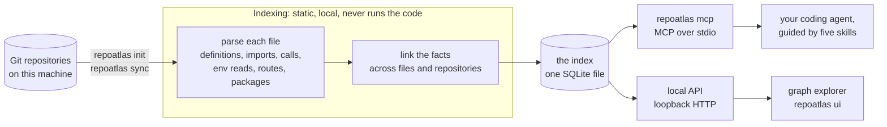

# RepoAtlas

RepoAtlas shows a coding agent what a change may affect before it makes the change.

It indexes the Git repositories on your machine and records how their code connects: imports and calls,
configuration and environment variables, packages that one repository provides and another consumes, and HTTP
requests matched to the routes that serve them. Give it a proposed change, such as a function, a file, a
configuration key or an environment variable, and it returns the places plausibly connected to it, ranked. Each
comes with the indexed path that explains why, including paths into other repositories.

The agent reads that source, decides what actually needs to change, and lets the compiler and tests confirm it.

RepoAtlas is deterministic and local. It parses source and runs no model of its own. Indexing makes no network
requests, and it never executes the code it reads.



## Why

When an agent changes a function, a config key or an API contract, text search finds the obvious call sites.
What it misses are the connections that do not share a spelling. One example is a consumer in another repository
that imports the function through a published package. Another is a service that reads the same environment
variable, and another is a client whose request reaches the handler being changed. RepoAtlas finds those paths in
the source and shows the evidence for each, so the agent investigates the right code, including code it would not
have thought to search.

## What it answers

| Question | What RepoAtlas returns |
|---|---|
| What might this change affect? | Ranked impact candidates, each with the indexed step and the file and lines behind it, across repositories |
| Where is this implemented, and what uses it? | Indexed source with file and line numbers, and the exact graph facts around one entity |
| Which repository provides this package, and who depends on it? | Declared, resolved and provided package facts from manifests and lockfiles |
| Which code calls this route, and what serves it? | The HTTP requests a repository makes and the routes it serves, matched by method and path |
| Is the index current? | How the index stands against your working trees |

Every piece of source RepoAtlas hands over carries an evidence id, and the citations in an agent's final answer
can be checked against the evidence actually supplied.

## An example

An agent is about to rename `createPaymentClient` in a shared `contracts` package. It asks RepoAtlas what that
may affect, and gets back something like this (illustrative, abbreviated):

```
seed    createPaymentClient   contracts/src/payment-client.ts:63

 1  createClients    web/src/api/clients.ts:20        uses (call)  exact  contracts -> web
 2  loadInvoice      billing/src/invoices.ts:42       uses (call)  exact  via package @acme/contracts, repository billing
 3  createServices   web/src/app/services.tsx:11      uses (call)  exact  via createClients

tests    web/src/__tests__/render.tsx:21, billing/test/invoices.spec.ts:8
omitted  314 candidates past the budget; this list is not exhaustive
```

Each line names the file and lines to read, and the step that connects it to the change. A candidate is a
reason to look, not a verdict that something will break.

## What it is not

- **Not a breakage oracle.** Candidates are plausible, source-backed paths. The compiler, the tests and the running
  code decide what actually breaks.
- **Not a substitute for reading source.** RepoAtlas points at the lines; the agent reads them.
- **Not an answer engine.** It runs no model and does no reasoning. The agent on the other end does both.
- **Not a runtime tracer.** Every link comes from static source. A matched route shows that the code agrees, not
  that a request reaches a live deployment.
- **Not a grep replacement.** Text search still has its place. RepoAtlas adds the connections text search cannot
  see.

## Install

From PyPI. You need `git` and [uv](https://docs.astral.sh/uv/), which brings its own Python 3.13 and keeps
RepoAtlas in an environment of its own, apart from your projects' environments:

```bash
uv tool install symasc-repoatlas
claude mcp add --scope user repoatlas -- repoatlas mcp   # connect Claude Code
repoatlas init                                           # index every Git repository under your home directory
```

The package is `symasc-repoatlas`; the command is `repoatlas`. It is not affiliated with the `repoatlas` package
on PyPI or with repoatlas.com. Update with `uv tool upgrade symasc-repoatlas`.

The five agent skills ship inside the package. To give them to Claude Code:

```bash
mkdir -p ~/.claude/skills
cp -r "$(uv tool dir)"/symasc-repoatlas/lib/python3*/site-packages/repoatlas/skills/repoatlas-* ~/.claude/skills/
```

The graph explorer comes in the package too: `repoatlas ui` opens it, with nothing else to install.

To work on RepoAtlas itself, install from a checkout instead. Building the explorer from source there needs
Node.js 22 or later:

```bash
git clone https://github.com/Symasc/RepoAtlas && cd RepoAtlas
./install.sh --root ~/work/repos     # install, then index every Git repository under ~/work/repos
```

The installer puts `repoatlas` on your PATH, installs and builds the explorer, registers the MCP server with
Claude Code and links the five skills. It skips any step that is already done, so after a `git pull` you can run
it again to update. What each step does, how to do them by hand and how to connect another agent are in
[`docs/installation.md`](https://github.com/Symasc/RepoAtlas/blob/master/docs/installation.md).

RepoAtlas serves its tools to an agent over the Model Context Protocol on stdio, with `repoatlas mcp`. For any
other client, register the `repoatlas` command (from a checkout, the absolute path to `.venv/bin/repoatlas`) with
the argument `mcp`. [`docs/agent-integration.md`](https://github.com/Symasc/RepoAtlas/blob/master/docs/agent-integration.md) covers
what the agent gets.

The index does not refresh itself. After you change code, run `repoatlas sync`.

## Using it with an agent

The MCP server exposes ten tools. Five skills teach an agent which tools to use for which task:

| Skill | For |
|---|---|
| [`repoatlas-change-impact`](https://github.com/Symasc/RepoAtlas/blob/master/skills/repoatlas-change-impact/SKILL.md) | what a proposed change may affect |
| [`repoatlas-code-trace`](https://github.com/Symasc/RepoAtlas/blob/master/skills/repoatlas-code-trace/SKILL.md) | where something is defined, what calls or uses it, and how code connects across files, services and repositories |
| [`repoatlas-dependencies`](https://github.com/Symasc/RepoAtlas/blob/master/skills/repoatlas-dependencies/SKILL.md) | which packages are declared, resolved and provided, and by whom |
| [`repoatlas-http`](https://github.com/Symasc/RepoAtlas/blob/master/skills/repoatlas-http/SKILL.md) | which code calls a route, and what serves it |
| [`repoatlas-index`](https://github.com/Symasc/RepoAtlas/blob/master/skills/repoatlas-index/SKILL.md) | what is indexed, how current it is, and updating it |

The skills are vendor-neutral and ship inside the installed package. The detailed contract they share is
[`skills/repoatlas-code-trace/references/contracts.md`](https://github.com/Symasc/RepoAtlas/blob/master/skills/repoatlas-code-trace/references/contracts.md).

## The graph explorer

```bash
repoatlas ui
```

This opens a local web app in your browser that draws the index. It shows the repositories and the links between
them, then directories, files and the names declared in them. A file opens on its code. Select a name to trace
everything connected to it, or a directory to see what a change there may reach.

`repoatlas ui` serves the explorer at <http://127.0.0.1:7318> and stops on Ctrl-C. An installed release carries
the explorer already built, and the local API serves it, so there is no Node.js and no second server. From a
checkout, it runs the explorer's own server beside the local API instead: the first run installs the explorer's
packages and builds it, and later runs rebuild it only when its sources change. Options: `--port`, `--no-open`,
and in a checkout `--dev` (hot reload, for working on the explorer) and `--rebuild`. The MCP server knows
nothing of it: the explorer is for you, and the tools are for the agent. See [`frontend/README.md`](https://github.com/Symasc/RepoAtlas/blob/master/frontend/README.md).

## Command line

The CLI covers indexing, quick lookups and the two ways of serving the index:

```bash
repoatlas init ~/work/repos        # index every repository under a root directory
repoatlas sync                     # update the index
repoatlas status                   # how the index stands against the working tree
repoatlas repos                    # list indexed repositories
repoatlas locate "Where is SERVICE_HOST configured?"   # ranked file-and-line evidence
repoatlas ui                       # open the graph explorer
repoatlas mcp                      # serve the tools to an agent
repoatlas serve                    # the local HTTP API alone (see docs/local-api.md)
```

Inside a repository, `sync` and `status` apply to that repository; at the configured root, they apply to all of
them. From anywhere else, `sync` updates every repository and `status` asks you to name one:
`repoatlas status service-a`. The commands that report accept
`--json`.

On a terminal, `init` and `sync` show how far they have got:

```
[2/4] lvl             ██████████████████████████░░░░░░  81%  1,234/1,505 files
Linking               ███████████████████░░░░░░░░░░░░░  60%  linking packages (4/5)
```

The bar counts the files each repository needs reindexed, then the five stages of the pass that links them. It is
drawn on stderr and erased when the run ends, so the report and `--json` output are what they would be without it.
Piped or redirected, nothing is drawn.

Semantic search is optional. `repoatlas sync --embed` downloads a small local embedding model once (about 67 MB)
and uses it from then on. Until you run it, semantic retrieval is off and nothing else changes.

## What it understands

| | |
|---|---|
| Parsed structurally (definitions, imports, calls, environment reads) | Python, TypeScript, JavaScript, Bash |
| Indexed and searchable as text | Ruby, Salt, Jinja, YAML, JSON, Dockerfile, documentation |
| Package facts | PyPI, npm and RubyGems manifests and lockfiles |
| HTTP routes | OpenAPI 3, Swagger 2, FastAPI, Flask, Express, NestJS |
| HTTP calls | fetch and request wrappers, requests, httpx, axios |

Across repositories, RepoAtlas links code through the packages one repository provides and another declares,
and through HTTP where a service's own source states where it is published. What each extractor reads, and what
it does not, is in [`docs/ARCHITECTURE.md`](https://github.com/Symasc/RepoAtlas/blob/master/docs/ARCHITECTURE.md).

## Safety

- Repositories are treated as untrusted input and are never executed: no scripts, imports, package lifecycle
  hooks or builds. Git runs through a read-only wrapper with hooks disabled.
- Secret files (`.env`, `*.pem`, `*.key`, `id_rsa`, `id_ed25519`) are excluded before any content is read.
- Installation is the only step that downloads anything. The parser grammars are pinned, hash-verified package
  dependencies, so indexing needs no network. Their licenses are in
  [`THIRD_PARTY_NOTICES.md`](https://github.com/Symasc/RepoAtlas/blob/master/THIRD_PARTY_NOTICES.md).
- `repoatlas sync` changes the index only, never your source, and nothing syncs on its own.
- `repoatlas ui` never runs repository code. An installed release runs no Node.js at all; from a checkout it
  runs Node.js on RepoAtlas's own explorer, with its telemetry off. It listens on loopback only and answers the
  explorer's calls only from the explorer's own pages. The browser never holds the API's token, and in a
  checkout the token reaches the explorer's server through a file only you can read, never through its arguments
  or environment.

## Docker

```bash
REPOS_DIR=/path/to/your/repos docker compose up -d
REPOS_DIR=/path/to/your/repos docker compose run --rm repoatlas init /repos
```

Repositories are mounted read-only and the index lives on a separate volume. The container runs as a non-root
user with a read-only root filesystem and all capabilities dropped. It carries the CLI and the MCP server, not
the explorer.

## Documentation

- [`docs/installation.md`](https://github.com/Symasc/RepoAtlas/blob/master/docs/installation.md): installing, updating, uninstalling and troubleshooting
- [`docs/agent-integration.md`](https://github.com/Symasc/RepoAtlas/blob/master/docs/agent-integration.md): connecting an agent over MCP
- [`skills/`](https://github.com/Symasc/RepoAtlas/blob/master/skills/): the agent skills
- [`frontend/README.md`](https://github.com/Symasc/RepoAtlas/blob/master/frontend/README.md): the graph explorer
- [`docs/local-api.md`](https://github.com/Symasc/RepoAtlas/blob/master/docs/local-api.md): the loopback HTTP API the explorer reads
- [`docs/ARCHITECTURE.md`](https://github.com/Symasc/RepoAtlas/blob/master/docs/ARCHITECTURE.md): how RepoAtlas is built
- [`docs/agent-efficiency.md`](https://github.com/Symasc/RepoAtlas/blob/master/docs/agent-efficiency.md): request changes and their evaluation
- [`docs/releasing.md`](https://github.com/Symasc/RepoAtlas/blob/master/docs/releasing.md): publishing a release to PyPI from a version tag
- [`docs/V1_SPEC.md`](https://github.com/Symasc/RepoAtlas/blob/master/docs/V1_SPEC.md): the original specification, kept as the record of V1

## Development

```bash
uv sync --all-groups
uv run pytest -n auto    # the default suite, on every core
uv run pytest -m slow    # slower tests; downloads the embedding model once
uv run ruff check .
uv run ruff format --check .
uv run pyright
```

The explorer has its own checks (`cd frontend && pnpm check`, and `pnpm e2e` against a real API); see
[`frontend/README.md`](https://github.com/Symasc/RepoAtlas/blob/master/frontend/README.md#checks). For working on it, `repoatlas ui --dev` runs its development
server against the live index, with hot reload.
