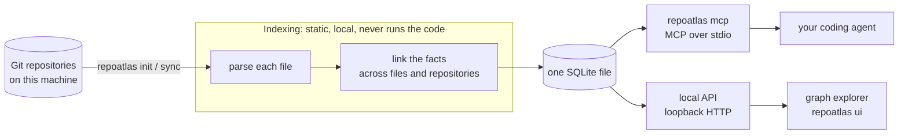

# RepoAtlas

[](https://pypi.org/project/symasc-repoatlas/)
[](https://www.python.org/downloads/)
[](https://github.com/Symasc/RepoAtlas/actions/workflows/coverage.yml)
[](https://github.com/Symasc/RepoAtlas/blob/master/LICENSE)

**Source-backed code intelligence for coding agents, across every repository on your machine.**

RepoAtlas indexes your local Git repositories and records how their code connects: imports and calls, environment
variables, packages one repository provides and another consumes, and HTTP requests matched to the handlers that
serve them. Your agent asks it over MCP what a change may affect, and gets ranked answers that each name the file
and lines to read. It is deterministic and local: it runs no model, needs no network to index, and never executes
the code it reads.


Text search finds the obvious call sites. RepoAtlas finds the ones that do not share a spelling: a consumer in
another repository that imports a function through a published package, a service that reads the same environment
variable, a client whose HTTP request reaches the handler being changed.

## Features

- **Change impact**: ranked candidates for what a change to a function, file, config key or environment variable
  may affect, each with the step that connects it.
- **Cross-repository tracing** across imports, calls and package relationships.
- **HTTP linking** between the requests one service makes and the handlers another serves.
- **Package intelligence** from PyPI, npm and RubyGems manifests and lockfiles.
- **Checkable evidence**: every result names indexed files and lines.
- **MCP server, agent skills and a graph explorer** for browsing the index down to the evidence behind each link.

## Quick start

You need `git` and [uv](https://docs.astral.sh/uv/). RepoAtlas runs on Python 3.10 or later; uv installs one if you
have none.

```bash
uv tool install symasc-repoatlas   # install
repoatlas init                     # index every Git repository under your home directory
repoatlas ui                       # open the graph explorer at http://127.0.0.1:7318
```

Use `repoatlas init ~/work/repos` to index a narrower directory. The index does not refresh itself: run
`repoatlas sync` after you change code. Update RepoAtlas with `uv tool upgrade symasc-repoatlas`.

### Connect your agent

RepoAtlas is an MCP server over stdio. Register the command `repoatlas` with the argument `mcp`:

| Agent | Register RepoAtlas |
|---|---|
| GitHub Copilot in VS Code | `code --add-mcp '{"name":"repoatlas","command":"repoatlas","args":["mcp"]}'` |
| GitHub Copilot CLI | `copilot mcp add repoatlas -- repoatlas mcp` |
| Claude Code | `claude mcp add --scope user repoatlas -- repoatlas mcp` |
| Any other MCP client | the command `repoatlas` with the argument `mcp`, over stdio |

The five agent skills ship in the package. Copy them to where your agent reads skills:

```bash
mkdir -p ~/.agents/skills
cp -r "$(uv tool dir)"/symasc-repoatlas/lib/python3*/site-packages/repoatlas/skills/repoatlas-* ~/.agents/skills/
```

`~/.agents/skills` is read by GitHub Copilot; Claude Code reads `~/.claude/skills` instead. See
[`docs/agent-integration.md`](https://github.com/Symasc/RepoAtlas/blob/master/docs/agent-integration.md).

### Install from source

Building the explorer from a checkout needs Node.js 20.19 or later.

```bash
git clone https://github.com/Symasc/RepoAtlas && cd RepoAtlas
./install.sh --root ~/work/repos     # install, then index every repository under ~/work/repos
```

The installer puts `repoatlas` on your PATH, builds the explorer, and registers the MCP server and skills with
Claude Code if it finds it. Run it again after a `git pull`. See
[`docs/installation.md`](https://github.com/Symasc/RepoAtlas/blob/master/docs/installation.md) for each step and for
troubleshooting.

## Using RepoAtlas

### With a coding agent

The MCP server exposes eleven tools. Five skills teach an agent which tool fits which task:

| Skill | For |
|---|---|
| [`repoatlas-change-impact`](https://github.com/Symasc/RepoAtlas/blob/master/skills/repoatlas-change-impact/SKILL.md) | what a proposed change may affect |
| [`repoatlas-code-trace`](https://github.com/Symasc/RepoAtlas/blob/master/skills/repoatlas-code-trace/SKILL.md) | where something is defined, what uses it, how code connects |
| [`repoatlas-dependencies`](https://github.com/Symasc/RepoAtlas/blob/master/skills/repoatlas-dependencies/SKILL.md) | which packages are declared, resolved and provided, and by whom |
| [`repoatlas-http`](https://github.com/Symasc/RepoAtlas/blob/master/skills/repoatlas-http/SKILL.md) | which code calls a route, and what serves it |
| [`repoatlas-index`](https://github.com/Symasc/RepoAtlas/blob/master/skills/repoatlas-index/SKILL.md) | what is indexed, how current it is, and updating it |

### Graph explorer

`repoatlas ui` opens a local web app that draws the index: repositories and the links between them, then
directories, files and the names declared in them. Select a name to trace what is connected to it, or a link to see
its evidence. Its options and how it runs from a checkout are in
[`frontend/README.md`](https://github.com/Symasc/RepoAtlas/blob/master/frontend/README.md).

### Command line

```bash
repoatlas init ~/work/repos        # index every repository under a directory
repoatlas sync                     # update the index
repoatlas status                   # how the index stands against the working tree
repoatlas repos                    # list indexed repositories
repoatlas locate "Where is SERVICE_HOST configured?"   # ranked file-and-line evidence
repoatlas ui                       # open the graph explorer
repoatlas mcp                      # serve the tools to an agent
repoatlas serve                    # the local HTTP API alone
```

Inside a repository, `sync` and `status` apply to that repository; at the configured root, they apply to all of
them. The commands that report accept `--json`.

## Example

An agent is about to rename `createPaymentClient` in a shared `contracts` package. It asks RepoAtlas what that may
affect and gets back something like this (illustrative, abbreviated):

```
seed    createPaymentClient   contracts/src/payment-client.ts:63

 1  createClients    web/src/api/clients.ts:20        uses (call)  exact  contracts -> web
 2  loadInvoice      billing/src/invoices.ts:42       uses (call)  exact  via package @acme/contracts, repository billing
 3  createServices   web/src/app/services.tsx:11      uses (call)  exact  via createClients

tests    web/src/__tests__/render.tsx:21, billing/test/invoices.spec.ts:8
omitted  314 candidates past the budget; this list is not exhaustive
```

Each line names the file and lines to read, and the step that connects it to the change. A candidate is a reason to
look, not a verdict that something will break.

## How it works



[`docs/ARCHITECTURE.md`](https://github.com/Symasc/RepoAtlas/blob/master/docs/ARCHITECTURE.md) describes every stage.

## What RepoAtlas understands

| Area | Covered |
|---|---|
| Code | Python, TypeScript, JavaScript, Bash: definitions, imports, calls, environment reads |
| Persistence | Prisma, PostgreSQL DDL, Knex and SQL queries, typed value mappings |
| GraphQL | Schemas, operations and fragments, codegen and resolver configurations, federated supergraphs |
| Configuration and deployment | YAML, JSON, Salt, Jinja, Dockerfiles, docker-compose, Helm |
| Packages | PyPI, npm and RubyGems manifests and lockfiles |
| HTTP routes served | FastAPI, Flask, Express, NestJS, Fastify, OpenAPI 3 and Swagger 2 |
| HTTP requests made | fetch, axios, superagent, request wrappers, requests and httpx |
| Where a service is reachable | OpenAPI `servers`, docker-compose services, Kubernetes Services and Ingress hosts |
| Everything else | searchable as text |

Links come from configuration and from what the source states, never from matching names alone. Each binding, and
each refusal, is a stored decision. What each extractor reads, and what it does not, is in
[`docs/ARCHITECTURE.md`](https://github.com/Symasc/RepoAtlas/blob/master/docs/ARCHITECTURE.md).

## Scope and limitations

- **It does not decide what breaks.** A candidate is a reason to look. The compiler, the tests and the running code
  decide.
- **It is static, not a runtime tracer.** A matched route shows that the code agrees, not that a request reaches a
  live deployment. A request whose base URL comes from runtime data is counted, not linked.
- **It does no reasoning.** It runs no model. The agent does the reasoning, reading the source each answer names.

## Security and privacy

- Repositories are untrusted input and are never executed: no scripts, imports, package hooks or builds. Git runs
  through a read-only wrapper with hooks disabled.
- Secret files (`.env`, `*.pem`, `*.key`, `id_rsa`, `id_ed25519`) are excluded before any content is read.
- Installation is the only step that downloads anything. Indexing needs no network. Third-party licenses are in
  [`THIRD_PARTY_NOTICES.md`](https://github.com/Symasc/RepoAtlas/blob/master/THIRD_PARTY_NOTICES.md).
- `repoatlas sync` changes the index only, never your source, and nothing syncs on its own.
- The explorer and the local API listen on loopback only. The API requires a token, and the browser never holds it.

## Documentation

- [`docs/installation.md`](https://github.com/Symasc/RepoAtlas/blob/master/docs/installation.md): installing, updating, uninstalling, troubleshooting
- [`docs/agent-integration.md`](https://github.com/Symasc/RepoAtlas/blob/master/docs/agent-integration.md): connecting an agent over MCP
- [`skills/`](https://github.com/Symasc/RepoAtlas/blob/master/skills/): the agent skills
- [`frontend/README.md`](https://github.com/Symasc/RepoAtlas/blob/master/frontend/README.md): the graph explorer
- [`docs/local-api.md`](https://github.com/Symasc/RepoAtlas/blob/master/docs/local-api.md): the loopback HTTP API
- [`docs/ARCHITECTURE.md`](https://github.com/Symasc/RepoAtlas/blob/master/docs/ARCHITECTURE.md): how RepoAtlas is built
- [`docs/agent-efficiency.md`](https://github.com/Symasc/RepoAtlas/blob/master/docs/agent-efficiency.md): request changes and their evaluation
- [`docs/releasing.md`](https://github.com/Symasc/RepoAtlas/blob/master/docs/releasing.md): publishing a release to PyPI
- [`docs/V1_SPEC.md`](https://github.com/Symasc/RepoAtlas/blob/master/docs/V1_SPEC.md): the original V1 specification

## Project status

RepoAtlas is in early development. Its commands, tools and APIs may change between 0.x versions. It runs on Linux and
macOS; on Windows, use WSL.

## Development

```bash
uv sync --all-groups
uv run pytest -n auto    # the default suite, on every core
uv run pytest -m slow    # slower tests, deselected by default
uv run ruff check .
uv run ruff format --check .
uv run pyright
```

The explorer has its own checks: `cd frontend && pnpm check`, and `pnpm e2e` (see
[`frontend/README.md`](https://github.com/Symasc/RepoAtlas/blob/master/frontend/README.md#checks)). To work on the
explorer, `repoatlas ui --dev` runs its development server against the live index.

## Contributing

Report bugs and suggest features in
[GitHub Issues](https://github.com/Symasc/RepoAtlas/issues). Before a pull request, run the checks under
[Development](#development). For a larger change, open an issue first to agree on the approach.

## License

[MIT](https://github.com/Symasc/RepoAtlas/blob/master/LICENSE). Not affiliated with the `repoatlas` package on PyPI or
with repoatlas.com.
