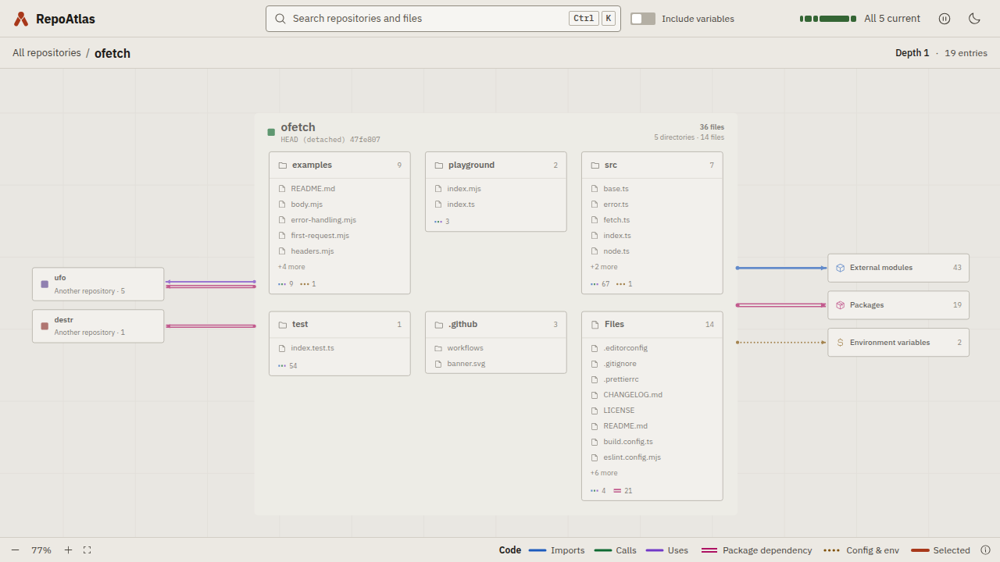
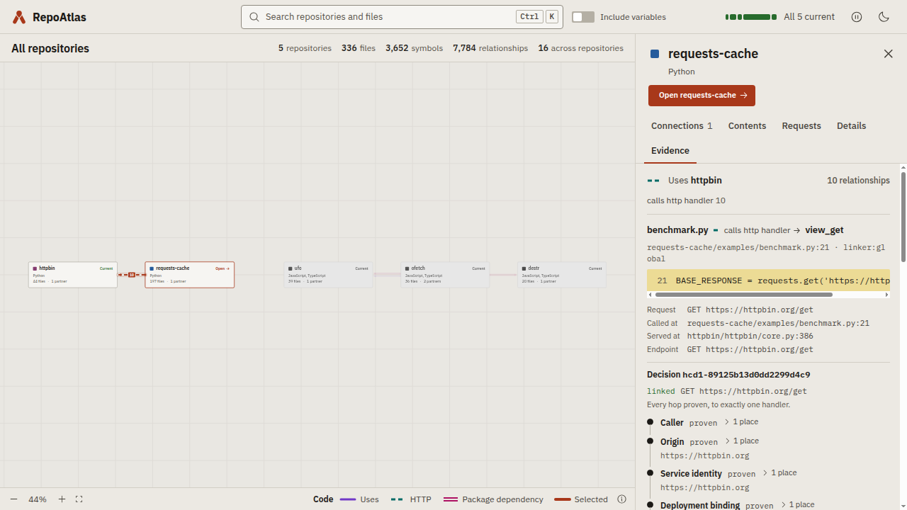
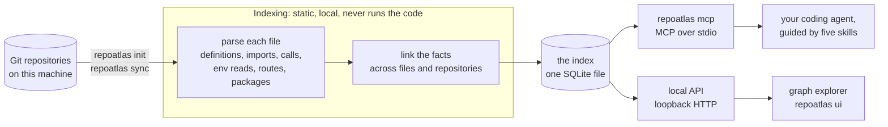

# RepoAtlas

[](https://pypi.org/project/symasc-repoatlas/)
[](https://www.python.org/downloads/)
[](https://github.com/Symasc/RepoAtlas/actions/workflows/coverage.yml)
[](https://github.com/Symasc/RepoAtlas/blob/master/LICENSE)

**Source-backed code intelligence for coding agents, across every repository on your machine.**

RepoAtlas indexes your local Git repositories and records how their code connects: imports and calls,
configuration and environment variables, packages that one repository provides and another consumes, and HTTP
requests matched to the handlers that serve them. Your coding agent asks it, over MCP, what a change may affect,
and gets ranked answers that each name the file and lines to read. It is deterministic and local: it runs no
model, indexing needs no network, and it never executes the code it reads.



## Why RepoAtlas?

When an agent changes a function, a config key or an API contract, text search finds the obvious call sites. It
misses the connections that do not share a spelling: a consumer in another repository that imports the function
through a published package, a service that reads the same environment variable, a client whose HTTP request
reaches the handler being changed. RepoAtlas finds those paths in the source and shows the evidence for each, so
the agent reads the right code, including code it would not have thought to search.

## Features

- **Change impact analysis**: ranked candidates for what a change to a function, file, config key or environment
  variable may affect, each with the step that connects it to the change.
- **Cross-repository tracing**: follows imports, calls and package relationships across repository boundaries.
- **HTTP linking**: matches the requests one service makes to the handlers another serves, when the source shows
  where that service is reachable: an OpenAPI spec, docker-compose, or Kubernetes and Helm.
- **Package intelligence**: declared, resolved and provided packages from PyPI, npm and RubyGems manifests and
  lockfiles, and which repository depends on which.
- **Evidence you can check**: every result names indexed files and lines, and carries an evidence id that an
  agent's final answer can be verified against.
- **MCP server and agent skills**: ten tools over the Model Context Protocol, and five skills that teach an agent
  which tool fits which task.
- **Graph explorer**: a local web app for browsing repositories, files, names and the links between them, down to
  the evidence behind each link.
- **Local and deterministic**: no model, no network while indexing, and repository code is never executed.

## Quick start

You need `git` and [uv](https://docs.astral.sh/uv/). RepoAtlas runs on Python 3.10 or later, and uv brings one if you
have none; it keeps RepoAtlas in an environment of its own, apart from your projects' environments.

```bash
uv tool install symasc-repoatlas   # install
repoatlas init                     # index every Git repository under your home directory
repoatlas ui                       # open the graph explorer
```

To index a narrower directory, run `repoatlas init ~/work/repos` instead. The index does not refresh itself:
after you change code, run `repoatlas sync`. To update RepoAtlas, run `uv tool upgrade symasc-repoatlas`.

### Connect your agent

RepoAtlas is an MCP server that runs over stdio, so it works with any agent that supports the Model Context
Protocol. Register the command `repoatlas` with the argument `mcp`:

| Agent | Register RepoAtlas |
|---|---|
| GitHub Copilot in VS Code | `code --add-mcp '{"name":"repoatlas","command":"repoatlas","args":["mcp"]}'` |
| GitHub Copilot CLI | `copilot mcp add repoatlas -- repoatlas mcp` |
| Claude Code | `claude mcp add --scope user repoatlas -- repoatlas mcp` |
| Any other MCP client | the command `repoatlas` with the argument `mcp`, over stdio |

The five agent skills ship in the package as standard `SKILL.md` folders. Copy them to where your agent looks for
skills: `~/.agents/skills` is read by GitHub Copilot in VS Code and the Copilot CLI, and `~/.claude/skills` by
Claude Code.

```bash
mkdir -p ~/.agents/skills
cp -r "$(uv tool dir)"/symasc-repoatlas/lib/python3*/site-packages/repoatlas/skills/repoatlas-* ~/.agents/skills/
```

Then start a new session and ask your agent something RepoAtlas answers, such as what renaming a function would
affect. [`docs/agent-integration.md`](https://github.com/Symasc/RepoAtlas/blob/master/docs/agent-integration.md)
covers what the agent gets.

### Install from source

To work on RepoAtlas itself, install from a checkout. Building the explorer from source needs Node.js 20.19 or later.

```bash
git clone https://github.com/Symasc/RepoAtlas && cd RepoAtlas
./install.sh --root ~/work/repos     # install, then index every Git repository under ~/work/repos
```

The installer puts `repoatlas` on your PATH and builds the explorer. If it finds Claude Code, it also registers
the MCP server and links the skills there; for any other agent, connect it as above. Run it again after a
`git pull` to update.
[`docs/installation.md`](https://github.com/Symasc/RepoAtlas/blob/master/docs/installation.md) covers each step,
installing by hand, and troubleshooting.

## Using RepoAtlas

### With a coding agent

The MCP server exposes ten tools. Five skills teach an agent which tools to use for which task:

| Skill | For |
|---|---|
| [`repoatlas-change-impact`](https://github.com/Symasc/RepoAtlas/blob/master/skills/repoatlas-change-impact/SKILL.md) | what a proposed change may affect |
| [`repoatlas-code-trace`](https://github.com/Symasc/RepoAtlas/blob/master/skills/repoatlas-code-trace/SKILL.md) | where something is defined, what calls or uses it, and how code connects across files, services and repositories |
| [`repoatlas-dependencies`](https://github.com/Symasc/RepoAtlas/blob/master/skills/repoatlas-dependencies/SKILL.md) | which packages are declared, resolved and provided, and by whom |
| [`repoatlas-http`](https://github.com/Symasc/RepoAtlas/blob/master/skills/repoatlas-http/SKILL.md) | which code calls a route, and what serves it |
| [`repoatlas-index`](https://github.com/Symasc/RepoAtlas/blob/master/skills/repoatlas-index/SKILL.md) | what is indexed, how current it is, and updating it |

The skills are vendor-neutral. The contract they share is in
[`contracts.md`](https://github.com/Symasc/RepoAtlas/blob/master/skills/repoatlas-code-trace/references/contracts.md).

### Graph explorer

```bash
repoatlas ui
```

This opens a local web app at <http://127.0.0.1:7318> that draws the index: the repositories and the links
between them, then directories, files and the names declared in them. A file opens on its code. Select a name to
trace everything connected to it, a directory to see what a change there may reach, or a link to see the evidence
behind it.



The explorer ships in the package and needs no Node.js. It is for you; the agent uses the MCP tools. Its options,
and how it runs from a checkout, are in
[`frontend/README.md`](https://github.com/Symasc/RepoAtlas/blob/master/frontend/README.md).

### Command line

```bash
repoatlas init ~/work/repos        # index every repository under a directory
repoatlas sync                     # update the index
repoatlas status                   # how the index stands against the working tree
repoatlas repos                    # list indexed repositories
repoatlas locate "Where is SERVICE_HOST configured?"   # ranked file-and-line evidence
repoatlas ui                       # open the graph explorer
repoatlas mcp                      # serve the tools to an agent
repoatlas serve                    # the local HTTP API alone
```

Inside a repository, `sync` and `status` apply to that repository; at the configured root, they apply to all of
them. From anywhere else, `sync` updates every repository and `status` asks you to name one. The commands that
report accept `--json`.

## Example

An agent is about to rename `createPaymentClient` in a shared `contracts` package. It asks RepoAtlas what that
may affect, and gets back something like this (illustrative, abbreviated):

```
seed    createPaymentClient   contracts/src/payment-client.ts:63

 1  createClients    web/src/api/clients.ts:20        uses (call)  exact  contracts -> web
 2  loadInvoice      billing/src/invoices.ts:42       uses (call)  exact  via package @acme/contracts, repository billing
 3  createServices   web/src/app/services.tsx:11      uses (call)  exact  via createClients

tests    web/src/__tests__/render.tsx:21, billing/test/invoices.spec.ts:8
omitted  314 candidates past the budget; this list is not exhaustive
```

Each line names the file and lines to read, and the step that connects it to the change. A candidate is a reason
to look, not a verdict that something will break.

## How it works



RepoAtlas parses each file statically, links the facts across files and repositories, and stores them in one
SQLite file. Two transports read that index: the MCP server, for agents, and a loopback HTTP API, for the
explorer. The agent reads the source each answer names, decides what needs to change, and lets the compiler and
tests confirm it. [`docs/ARCHITECTURE.md`](https://github.com/Symasc/RepoAtlas/blob/master/docs/ARCHITECTURE.md)
describes every stage.

## What RepoAtlas understands

| | |
|---|---|
| Code: definitions, imports, calls, environment reads | Python, TypeScript, JavaScript, Bash |
| Persistence | Prisma schemas and their migrations and generated client; PostgreSQL DDL; Knex and SQL queries in TypeScript and Python; typed value mappings |
| GraphQL | Schema coordinates and same-file type links; operations and fragments, also in TypeScript `gql` templates; GraphQL Code Generator, ariadne-codegen and graphql-config configurations; resolver maps (Apollo, graphql-tools, graphql-yoga, Ariadne); federated supergraph copies; schema fetch scripts |
| Configuration and deployment | YAML, JSON, Salt states, Jinja templates, Dockerfiles, docker-compose, Helm charts |
| Packages | PyPI, npm and RubyGems manifests and lockfiles |
| HTTP routes served | FastAPI, Flask, Express, NestJS, Fastify, OpenAPI 3 and Swagger 2 specs |
| HTTP requests made | fetch, axios, superagent and request wrappers; requests and httpx |
| Where a service is reachable | OpenAPI `servers`, docker-compose services, Kubernetes Services and Ingress hosts in Helm charts |
| Searchable as text | everything else indexed, including Ruby and documentation |

Across repositories, RepoAtlas links code through the packages one repository provides and another declares, and
through HTTP when the source states where a service is reachable. What each extractor reads, and what it does
not, is in [`docs/ARCHITECTURE.md`](https://github.com/Symasc/RepoAtlas/blob/master/docs/ARCHITECTURE.md).

GraphQL `.graphql`, `.gql` and `.graphqls` files are parsed offline with source spans, each
definition named by its schema coordinate. Links come from configuration, never from names:
- generated code is linked to the definitions its GraphQL Code Generator configuration
  loads;
- a document is bound to the schema of the configuration whose `documents:` cover it;
- a resolver is bound to the schema of the construction that uses its map;
- a federated supergraph copy is tied to the service that provides each coordinate, through
  the deployment that serves the subgraph's URL and the schema that service loads.

Prisma schemas and PostgreSQL migrations are read too. A query is bound to a column only when
its client reads the environment variable the repository's own Prisma datasource reads, and an
explicit typed mapping (`Record<A, B>`, `dict[A, B]`) maps one enum's members to another's.

Every binding, and every refusal, is a stored decision, and a change-impact answer lists the
refusals made where its walk went. Matching names alone never connect schemas, databases or
repositories.

## Scope and limitations

RepoAtlas finds plausible, source-backed paths, and deliberately stops there:

- **It does not decide what breaks.** A candidate is a reason to look. The compiler, the tests and the running code
  decide what actually breaks.
- **It points at source; it does not replace reading it.** The agent reads the lines RepoAtlas names.
- **It does no reasoning.** It runs no model. The agent on the other end does the reasoning.
- **It is static, not a runtime tracer.** A matched route shows that the code agrees, not that a request reaches a
  live deployment. A request whose base URL comes from runtime data is counted, not linked.
- **It complements text search.** Text search still has its place; RepoAtlas adds the connections it cannot see.

## Security and privacy

- Repositories are treated as untrusted input and are never executed: no scripts, imports, package lifecycle hooks
  or builds. Git runs through a read-only wrapper with hooks disabled.
- Secret files (`.env`, `*.pem`, `*.key`, `id_rsa`, `id_ed25519`) are excluded before any content is read.
- Installation is the only step that downloads anything. The parser grammars are pinned, hash-verified package
  dependencies, so indexing needs no network. Their licenses are in
  [`THIRD_PARTY_NOTICES.md`](https://github.com/Symasc/RepoAtlas/blob/master/THIRD_PARTY_NOTICES.md).
- `repoatlas sync` changes the index only, never your source, and nothing syncs on its own.
- The explorer and the local API listen on loopback only. The API requires a token, the explorer answers only its
  own pages, and the browser never holds the token.

## Documentation

- [`docs/installation.md`](https://github.com/Symasc/RepoAtlas/blob/master/docs/installation.md): installing, updating, uninstalling and troubleshooting
- [`docs/agent-integration.md`](https://github.com/Symasc/RepoAtlas/blob/master/docs/agent-integration.md): connecting an agent over MCP
- [`skills/`](https://github.com/Symasc/RepoAtlas/blob/master/skills/): the agent skills
- [`frontend/README.md`](https://github.com/Symasc/RepoAtlas/blob/master/frontend/README.md): the graph explorer
- [`docs/local-api.md`](https://github.com/Symasc/RepoAtlas/blob/master/docs/local-api.md): the loopback HTTP API the explorer reads
- [`docs/ARCHITECTURE.md`](https://github.com/Symasc/RepoAtlas/blob/master/docs/ARCHITECTURE.md): how RepoAtlas is built
- [`docs/agent-efficiency.md`](https://github.com/Symasc/RepoAtlas/blob/master/docs/agent-efficiency.md): request changes and their evaluation
- [`docs/releasing.md`](https://github.com/Symasc/RepoAtlas/blob/master/docs/releasing.md): publishing a release to PyPI from a version tag
- [`docs/V1_SPEC.md`](https://github.com/Symasc/RepoAtlas/blob/master/docs/V1_SPEC.md): the original specification, kept as the record of V1

## Project status

RepoAtlas is in early development. 0.1.0 is its first release, and its commands, tools and APIs may change between
0.x versions. It runs on Linux and macOS; on Windows, use WSL.

## Development

```bash
uv sync --all-groups
uv run pytest -n auto    # the default suite, on every core
uv run pytest -m slow    # slower tests, deselected by default
uv run ruff check .
uv run ruff format --check .
uv run pyright
```

The explorer has its own checks: `cd frontend && pnpm check`, and `pnpm e2e` against a real API (see
[`frontend/README.md`](https://github.com/Symasc/RepoAtlas/blob/master/frontend/README.md#checks)). To work on it,
`repoatlas ui --dev` runs its development server against the live index, with hot reload.

## Contributing

Contributions are welcome. Report bugs and suggest features in
[GitHub Issues](https://github.com/Symasc/RepoAtlas/issues). Before a pull request, run the checks under
[Development](#development), and for a larger change, open an issue first to agree on the approach.

## License

RepoAtlas is released under the [MIT License](https://github.com/Symasc/RepoAtlas/blob/master/LICENSE). It is not
affiliated with the `repoatlas` package on PyPI or with repoatlas.com.
