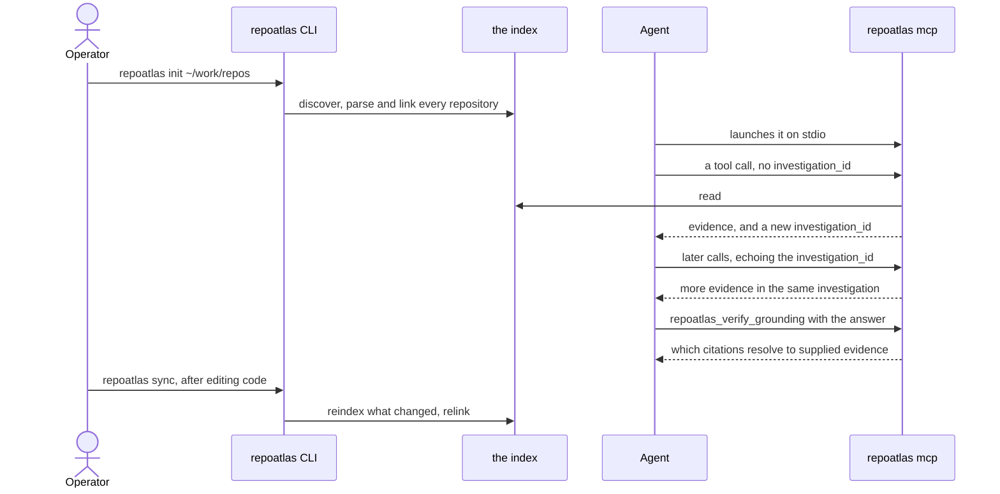
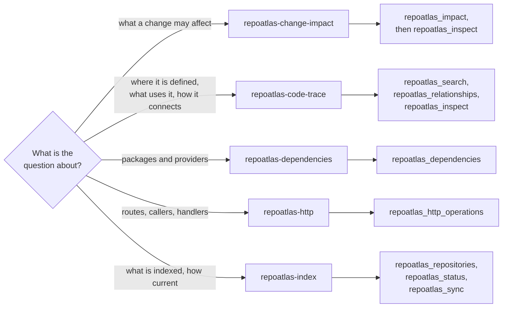

# Agent integration

RepoAtlas serves its capabilities to an agent over the Model Context Protocol on
stdio. This document covers setup. The behaviour an agent should follow lives in
the five task skills under [`skills/`](../skills/), starting with
[`skills/repoatlas-code-trace/SKILL.md`](../skills/repoatlas-code-trace/SKILL.md),
and is not repeated here.

For request migration notes, source previews, workspace HTTP discovery and the
completed-answer evaluation plan, see [agent efficiency](agent-efficiency.md).

**The short way.** With the PyPI package, the README's
[Connect your agent](../README.md#connect-your-agent) has the one-line
registration for GitHub Copilot, Claude Code and any other MCP client. From a
checkout, `./install.sh` does every step below for Claude Code: it indexes the
directory you name, registers the server and links the skills. See
[installation](installation.md). The rest of this page is what those steps do.



## 1. Index a workspace

Indexing is an operator action, done once with the existing CLI:

```bash
repoatlas init ~/work/repos
```

There is no MCP tool that initializes an index, and the server does not create
one. A server started against an unindexed workspace starts, and its tools report
`NOT_INITIALIZED` rather than failing silently.

Keeping the index current is also explicit. `repoatlas sync` on the command line
and the `repoatlas_sync` tool do the same thing; nothing syncs on its own.

## 2. Point an MCP client at the server

Configure the client to launch:

```bash
repoatlas mcp
```

A client starts the server directly, with no shell to expand an alias or `~`, so
the command must be on the PATH the client sees, or an absolute path:
`which repoatlas` prints it. A PyPI installation puts it in `~/.local/bin`; a
checkout's is `.venv/bin/repoatlas`. Registered for every project:

```bash
code --add-mcp '{"name":"repoatlas","command":"/path/to/repoatlas","args":["mcp"]}'  # GitHub Copilot in VS Code
copilot mcp add repoatlas -- /path/to/repoatlas mcp                                  # GitHub Copilot CLI
claude mcp add --scope user repoatlas -- /path/to/repoatlas mcp                      # Claude Code
```

For a client configured with JSON, the server is a stdio command with the
argument `mcp`; [installation](installation.md#other-agents) has the snippet.

It speaks JSON-RPC over stdin and stdout and runs until the transport ends. There
is no daemon, no socket, no pidfile and no port. Operational output goes to
stderr, because on this transport stdout carries protocol and nothing else.

The command takes no arguments. It reads the same configuration the CLI reads, so
`REPOATLAS_CONFIG` and `REPOATLAS_DB` work as they do everywhere else, and the
server is simply another client of the local installation. There is no
MCP-specific configuration file, database or root setting.

Nothing is inferred from the directory the client happens to launch the server in.
Every tool call states its own repository scope.

### What `tools/list` costs

The ten tool input schemas are advertised in full and are derived directly from
the V2 Pydantic request models, so the schema a client validates against is the
one the capability actually accepts. A compact JSON serialization of all ten
tool definitions currently measures 56,638 bytes, including descriptions and
schemas. This is a byte measurement, not model tokens; clients may expose only
selected definitions. See the dated comparison in the evaluation notes above.

Output schemas are deliberately omitted. Under the current MCP SDK they would add
substantial additional data to the same handshake without buying SDK-side validation
of the result path RepoAtlas uses, so the agent would pay for the whole response
contract at startup and get no checking for it.

There is no hand-maintained copy of any schema to drift from the models, and a
test asserts that what the transport advertises is exactly `model_json_schema()`.

### What a response costs

Every result is sent twice, as MCP requires: as structured content, and as a
text block holding the same JSON for clients that read only content blocks. The
text block is compact JSON. Which of the two a host forwards to its model is the
host's choice.

`repoatlas_search`, `repoatlas_inspect`, `repoatlas_relationships` and
`repoatlas_verify_grounding` also accept `presentation: "compact"`, which writes
each repeated fact once instead of per evidence item. The default, `full`, is
unchanged, and the capability does the same work either way.

## 3. Load the skills

Give the agent all five canonical skills. Each one covers one kind of task, and
its description says when to load it:

| Skill | For |
|---|---|
| `repoatlas-change-impact` | what a proposed change may affect |
| `repoatlas-code-trace` | where something is defined, what calls or uses it, and how code connects |
| `repoatlas-dependencies` | package declarations, resolutions and providers |
| `repoatlas-http` | routes, callers and handlers |
| `repoatlas-index` | what is indexed, freshness and sync |



The diagram is a map, not the policy: each skill's own `SKILL.md` says when it
applies and how to use its tools.

They are vendor-neutral and live at the repository root:

```
skills/repoatlas-code-trace/SKILL.md
skills/repoatlas-change-impact/SKILL.md   (and the three others beside them)
```

An installed copy ships inside the package, so a `pip`- or `uv`-installed
RepoAtlas carries them too:

```
<site-packages>/repoatlas/skills/<skill>/SKILL.md
```

Both are the same files; the wheel maps the root artifacts into the package rather
than keeping second copies. GitHub Copilot (VS Code and CLI) reads skills from
`~/.agents/skills/`, and Claude Code from `~/.claude/skills/`, where the installer
links the five. Wherever they go, install them side by side, one directory each:
they share one contract reference, `repoatlas-code-trace/references/contracts.md`,
through a relative link. If a client has its own convention for where skills or
instructions live, point it at these directories rather than transcribing them, so
there is one source of behavioural truth.

## 4. What the agent gets

Ten tools, and no resources or prompts:

```
repoatlas_repositories   repoatlas_status         repoatlas_search             repoatlas_inspect
repoatlas_impact         repoatlas_relationships  repoatlas_dependencies       repoatlas_http_operations
repoatlas_verify_grounding                        repoatlas_sync
```

Nine read. `repoatlas_sync` is the only one that changes anything, and what it
changes is the index, never repository source.

The graph explorer (`repoatlas ui`) is not among them. It is for the operator,
reads the index through the local API rather than through this server, and
nothing in this server knows of it.

Repository source is reachable only through the evidence-producing tools, which
enforce admission and record what they supply. No file resource is exposed, so
there is no second route to source text that bypasses that.

## 5. Investigations are process-local

An investigation is one reasoning task. The agent omits `investigation_id` to
start one and echoes the returned id to continue it. One server process serves
many investigations at once and they cannot read each other's evidence.

Nothing is persisted. When the server process ends, its investigations end with
it, and an id from a previous process comes back `UNKNOWN_INVESTIGATION` rather
than as a silently empty one. Evidence ids such as `E1` mean something only
inside the investigation that issued them.

## 6. No model, no network

RepoAtlas runs no model and makes no network request --- over MCP or anywhere
else. Retrieval, traversal, dependency reads and grounding verification are all
deterministic and local, and a full session including a sync completes with
outbound networking unavailable.

That includes parsing. The tree-sitter grammars for TypeScript, JavaScript and
Bash are package dependencies, installed with RepoAtlas and pinned exactly, so a
first sync on a fresh machine needs neither the network nor a warm cache.
Installation is the only step that downloads anything. Ruby files are indexed as
text but not parsed structurally; see the README's language table.

There is nothing to install first and nothing to configure: the agent is the
reasoner.

An installed HTTP library is not network use: the MCP SDK brings one
transitively, and on stdio nothing opens a connection.
