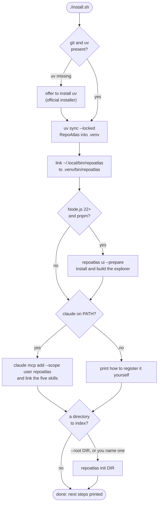

# Installing RepoAtlas

## From PyPI

To use RepoAtlas, install the released package, in an environment of its own:

```bash
uv tool install symasc-repoatlas
repoatlas init
```

That is everything, the graph explorer included: `repoatlas ui` serves it with no Node.js. Update with
`uv tool upgrade symasc-repoatlas`. Then connect your agent: RepoAtlas is the stdio MCP server `repoatlas mcp`. The
[README](../README.md#connect-your-agent) has the command for GitHub Copilot (VS Code and CLI), Claude Code and any
other MCP client, and where to put the five skills.

## From a checkout

To work on RepoAtlas, install from a checkout instead. One command takes a fresh checkout to a working
installation:

```bash
git clone https://github.com/Symasc/RepoAtlas && cd RepoAtlas
./install.sh
```

It installs RepoAtlas, puts `repoatlas` on your PATH, sets up the graph explorer, connects Claude Code if it finds
it, and offers to index a directory of repositories. For any other agent, see [Other agents](#other-agents). Every step is skipped when it is already done, so running it again
after a `git pull` is how you update.

## What you need

| | Needed for | Notes |
|---|---|---|
| `git` | everything | RepoAtlas reads repositories through git |
| [uv](https://docs.astral.sh/uv/) | everything | The installer offers to install it. uv fetches Python 3.13 itself if you do not have it |
| Node.js 22 or later, and pnpm 11 | building the explorer from source (`repoatlas ui` in a checkout) | Without them, everything else still works. pnpm can come from `npm install -g pnpm@11` or Node's `corepack`. A PyPI installation needs neither |
| [Claude Code](https://claude.com/claude-code) (`claude`) | connecting it automatically | Any MCP client works; see [Other agents](#other-agents) |

Linux and macOS are supported. On Windows, use WSL.

## What the installer does



1. **Prerequisites.** Checks for `git`, and for `uv`. If uv is missing it asks before installing it with uv's
   official installer. With `--yes` it does not ask, and with no terminal and no `--yes` it stops instead.
2. **RepoAtlas.** `uv sync --locked` installs RepoAtlas and the exact dependency versions `uv.lock` records into
   `.venv` in the checkout. This is the step that downloads packages; indexing never does.
3. **PATH.** Links `~/.local/bin/repoatlas` (or `$XDG_BIN_HOME/repoatlas`) to `.venv/bin/repoatlas`. If that
   directory is not on your PATH, it prints the line to add to your shell's startup file.
4. **The explorer.** With Node.js 22+ and pnpm present, runs `repoatlas ui --prepare`, which installs the
   explorer's packages and builds it, so the first `repoatlas ui` starts at once.
5. **Your agent.** With `claude` on PATH, registers the MCP server at user scope (every project sees it):
   `claude mcp add --scope user repoatlas -- <checkout>/.venv/bin/repoatlas mcp`. It also links the five skills
   into `~/.claude/skills/`. A server already registered under the name `repoatlas` is left as it is.
6. **A workspace.** Indexes the directory you name with `--root`, or asks for one. If a workspace is already
   indexed, it says so and leaves it.

Nothing the installer did not create is replaced. An existing `~/.local/bin/repoatlas` that is not its link, or a
skill directory of the same name, is left alone and reported.

### Options

| Option | Effect |
|---|---|
| `--root DIR` | index every Git repository under `DIR` at the end |
| `--yes` | never ask; take the defaults, including installing uv if it is missing |
| `--no-explorer` | skip the explorer, so Node.js is not needed |
| `--no-agent` | leave Claude Code's configuration and `~/.claude/skills` alone |

## After installing

```bash
repoatlas init ~/work/repos     # index every Git repository under a directory (once; default: your home directory)
repoatlas ui                    # open the graph explorer
repoatlas sync                  # update the index after you change code (from any directory)
```

Restart your agent so it starts the MCP server and loads the skills. Then ask it something RepoAtlas answers,
such as what a change to a function would affect.

## Installing by hand

The installer runs nothing you cannot run yourself:

```bash
uv sync --locked                                        # 1. install into .venv
ln -s "$PWD/.venv/bin/repoatlas" ~/.local/bin/repoatlas # 2. put it on PATH
repoatlas ui --prepare                                  # 3. optional: the explorer
claude mcp add --scope user repoatlas -- "$PWD/.venv/bin/repoatlas" mcp   # 4. the agent
mkdir -p ~/.claude/skills                               #    and its skills
for skill in skills/repoatlas-*; do ln -s "$PWD/$skill" ~/.claude/skills/; done
repoatlas init ~/work/repos                             # 5. index
```

An alias works as well as the link (`alias repoatlas="$PWD/.venv/bin/repoatlas"`), but an MCP client cannot use
an alias: it starts the server directly, with no shell. Always register the absolute path.

### Other agents

Any MCP client can run the server. Register a stdio server whose command is the absolute path to
`.venv/bin/repoatlas` and whose single argument is `mcp`. For GitHub Copilot:

```bash
code --add-mcp '{"name":"repoatlas","command":"/absolute/path/to/RepoAtlas/.venv/bin/repoatlas","args":["mcp"]}'  # VS Code
copilot mcp add repoatlas -- /absolute/path/to/RepoAtlas/.venv/bin/repoatlas mcp                                  # Copilot CLI
```

For a client configured with JSON, that is usually:

```json
{
  "mcpServers": {
    "repoatlas": {
      "command": "/absolute/path/to/RepoAtlas/.venv/bin/repoatlas",
      "args": ["mcp"]
    }
  }
}
```

Then give the agent the five skills in [`skills/`](../skills/), one directory each: GitHub Copilot (VS Code and
CLI) reads `~/.agents/skills/`. See [agent integration](agent-integration.md) for what the server offers.

## Updating

From PyPI: `uv tool upgrade symasc-repoatlas`. From a checkout:

```bash
git pull
./install.sh
```

`uv sync` brings the dependencies in line with the new lockfile. The next `repoatlas ui` rebuilds the explorer if
its sources changed, and the next `repoatlas sync` re-reads whatever a new parser version reads differently.

## Uninstalling

First remove the MCP server from your agent: `copilot mcp delete repoatlas` (Copilot CLI), **MCP: List Servers**
then **Uninstall** (VS Code), or `claude mcp remove repoatlas --scope user` (Claude Code). Remove the skills you
copied or linked, from `~/.agents/skills/` or `~/.claude/skills/`. Then:

```bash
uv tool uninstall symasc-repoatlas                    # a PyPI installation
rm ~/.local/bin/repoatlas                             # or, for a checkout, its link (then delete the checkout)
rm -rf ~/.config/repoatlas ~/.local/share/repoatlas   # configuration and the index
```

## Where things live

| What | Where | Override |
|---|---|---|
| Configuration, including the managed root | `~/.config/repoatlas/config.yaml` | `REPOATLAS_CONFIG` |
| The index | `~/.local/share/repoatlas/atlas.db` | `REPOATLAS_DB` |
| The local API's connection file | beside the index: `api.json` (`serve`), `ui-api.json` (`ui`) | `REPOATLAS_API_CONNECTION_FILE` |
| The explorer | `frontend/` in a checkout, built into `frontend/.next-ui/`; in a PyPI installation, `repoatlas/ui/explorer/` in the package | `--frontend`, `REPOATLAS_FRONTEND_DIR` |

## Troubleshooting

| Symptom | Cause and fix |
|---|---|
| `repoatlas: command not found` | `~/.local/bin` is not on PATH. Add `export PATH="$HOME/.local/bin:$PATH"` to your shell's startup file and open a new shell |
| A command exits with code 3 | Nothing is indexed yet: `repoatlas init <directory>` |
| `repoatlas ui`: "needs Node.js 22 or later" | In a checkout the explorer is built from source. Install Node.js 22+ (nodejs.org, or nvm), then run it again |
| `repoatlas ui`: "port 7318 is already in use" | Another explorer, or a `pnpm dev`, holds it. Stop it or use `repoatlas ui --port 7320` |
| `repoatlas ui`: "the explorer is not part of this installation" | This RepoAtlas was built without it. Install the release (`uv tool install symasc-repoatlas`), or pass `--frontend <checkout>/frontend` |
| The explorer shows an old version | In a checkout, `repoatlas ui --rebuild`. A PyPI installation's explorer is the release's: `uv tool upgrade symasc-repoatlas` |
| The agent does not see the tools | Restart the agent, then check what it has registered: `copilot mcp get repoatlas`, **MCP: List Servers** in VS Code, or `claude mcp get repoatlas`. If it cannot start `repoatlas`, register the absolute path that `which repoatlas` prints |
