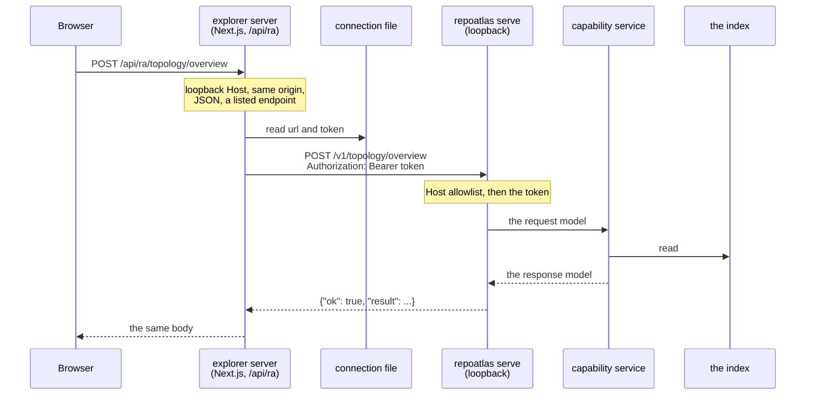
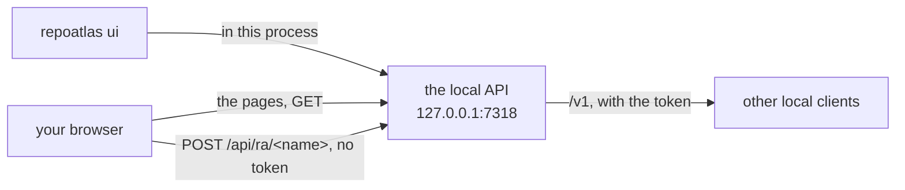
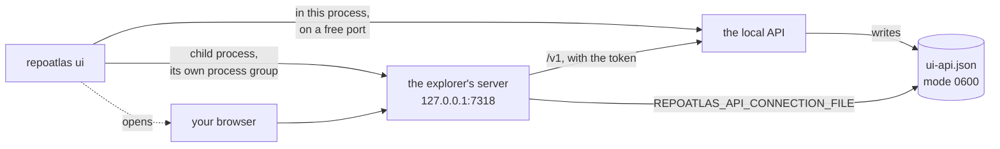

# The local API (`repoatlas-local-api/1`)

`repoatlas serve` makes the RepoAtlas capabilities available over HTTP on loopback, for a local app's
**server** process, such as the RepoAtlas frontend's Next.js server. That process holds the token and calls
this API on its browser's behalf. The browser never holds the token and never talks to this port. The one
exception is an installed release's `repoatlas ui`, where this server sends the explorer itself and answers its
pages at a door of its own ([below](#an-installed-release-one-server)); the browser still never holds the token.

It is a second transport beside `repoatlas mcp`, and like that one it only carries requests and responses.
Every answer comes from the same capability service over the same local index.



## The usual way: `repoatlas ui`

```
repoatlas ui [--port 7318] [--no-open] [--dev] [--rebuild] [--prepare] [--frontend DIR]
```

starts this API and the explorer together, which is the launcher this contract was written to allow. How
depends on which explorer it finds (see **Where the explorer is** below).

### An installed release: one server

A release carries the explorer exported as static files (`pnpm build:static`), in the package at
`repoatlas/ui/explorer/`. `repoatlas ui` then starts this API on `127.0.0.1:7318` with those files, and nothing
else: no Node.js, no child process.



- **The pages.** `GET` and `HEAD` of any path outside `/v1` and `/api/ra/` send a file from the export: `/` and
  a directory are their `index.html`, a name with no suffix is its `.html` page, and anything else is the
  export's `404.html` with status 404. A path segment of `..`, `.` or nothing, a backslash or a NUL is refused
  before the disk is read, and a file a link resolves to outside the export is not sent. `/_next/static/` files
  are named by their content and may be cached for a year; everything else is `no-cache`.
- **The door.** `POST /api/ra/<name>` answers the pages' calls without the token, with the same checks and the
  same refusals as the explorer's own server (`frontend/lib/server/proxy.ts`): a loopback `Host` naming this
  port (403 `HOST_NOT_ALLOWED`); no `Sec-Fetch-Site` other than `same-origin` or
  `none`, and no `Origin` other than `http://` and that `Host` (403 `CROSS_SITE_REQUEST`); a name the contract
  serves (404 `UNKNOWN_ENDPOINT`); then the body rules of `/v1` (415, 411, 413, 400). The answer is the
  capability's, as `/v1` gives it.
- **`/v1` is unchanged**, token and all, and the connection file is written as always, so another local client
  can use the same server.
- Every answer from the pages or the door also carries `X-Frame-Options: DENY` and `Referrer-Policy:
  no-referrer`, as the explorer's own server sends them.

### A checkout: the explorer's own server




- **The API** runs in the `repoatlas ui` process on a free loopback port, exactly as `repoatlas serve` runs it.
  Its connection file is `ui-api.json` beside the index (or `REPOATLAS_API_CONNECTION_FILE`), so a
  `repoatlas serve` running at the same time keeps its own `api.json`.
- **The explorer** runs as a child process: Node, running Next.js from the explorer's own `node_modules`, with
  `REPOATLAS_API_CONNECTION_FILE` naming that file. The token reaches it through the file only; it is never in an
  argument or in the child's environment, and `REPOATLAS_API_TOKEN` is removed from that environment if set.
- **Setup** happens on first use. The explorer's packages are installed (`pnpm install --frozen-lockfile`) when
  `node_modules` is missing or older than `package.json` and `pnpm-lock.yaml`, and a production build is made into
  `frontend/.next-ui/` when there is none or a source has changed since. `--prepare` does only this and exits.
- **Stopping.** Ctrl-C or SIGTERM stops the API and then the explorer's whole process group. If the explorer
  stops on its own, or never starts listening, the API is stopped too and the command exits 1. A taken port, a
  Node.js older than 22, or no explorer directory exits 2 before anything starts.

`--dev` runs the explorer's development server instead, with hot reload, against the same API. Next.js telemetry
is turned off in both modes.

### Where the explorer is

`--frontend` or `REPOATLAS_FRONTEND_DIR` when given, which may name the explorer's sources (a `frontend/` with its
`package.json` and `next.config.ts`) or an export of them (an `index.html` and `_next/`, such as `frontend/out`).
Otherwise the `frontend/` of the checkout RepoAtlas runs from, and failing that the export installed in the
package. A checkout's sources win over an export, so a developer always runs the explorer they are editing.
`--dev`, `--rebuild` and `--prepare` are for sources; with an export, `--prepare` has nothing to do and `--dev`
is refused. A RepoAtlas built without the explorer exits 2 and says so.

## Starting it on its own

```
repoatlas serve [--host 127.0.0.1] [--port 7317]
```

- **Host:** loopback only: `127.0.0.1`, `::1` or `localhost`, which binds `127.0.0.1`. Any other host is
  refused with exit code 2 before anything is opened.
- **Port:** `--port 0` picks a free port. A port already in use is refused with exit code 2.
- **Token:** `REPOATLAS_API_TOKEN` when set. It must be at least 32 printable ASCII characters with no
  spaces, or the server refuses to start (exit 2). When the variable is unset, a random token is generated.
  The token is never printed.
- **Stopping:** Ctrl-C or SIGTERM stops it cleanly.

On start it prints the URL and the connection file's path to stderr, never the token.

## Finding it: the connection file

The server writes a connection file:

```json
{"contract": "repoatlas-local-api/1", "url": "http://127.0.0.1:7317", "token": "…", "pid": 12345}
```

- **Path:** `REPOATLAS_API_CONNECTION_FILE` when set, otherwise `api.json` in the directory holding the index
  database.
- **Permissions:** written atomically and readable by its owner only (mode 0600).
- **Removal:** removed when the server stops, unless another server has replaced it since.

**A client locates the API only through `REPOATLAS_API_CONNECTION_FILE`.** It reads `url` and `token` from
that file, and checks that `contract` is the one it was built for. `repoatlas ui` is the launcher that starts
both processes and sets the variable for its child; a client still never discovers the file any other way.

## Requests

```
POST /v1/<name>
Host: 127.0.0.1:<port>
Authorization: Bearer <token>
Content-Type: application/json
Content-Length: <n>

<the capability's request, as a JSON object>
```

- **Host:** must be `127.0.0.1:<port>`, `localhost:<port>` or `[::1]:<port>`. This is the defence against
  DNS rebinding.
- **Body:** at most 1 MiB, sent with `Content-Length`; chunked bodies are refused. The body is validated by
  the capability's own request model, and is passed on unchanged.
- **Connections:** one request per connection (HTTP/1.0), each read on a thread of its own. Capability calls
  run one at a time, in the order they arrive, on the single thread that owns the index connection. A
  connection silent for 30 seconds is dropped.

`GET /v1` answers with the contract and the served names.

### Served

| Name | Capability |
|---|---|
| `repositories`, `status` | what is indexed, and how current it is |
| `search`, `inspect` | find evidence; read indexed source and recorded evidence |
| `relationships`, `impact` | what one entity is connected to; what a change may reach |
| `dependencies`, `http_operations` | declared packages; HTTP operations made and served |
| `topology/overview` | which repositories are linked to which, by kind: `observed`, `http`, `dependency` |
| `topology/children` | one page of a directory's or file's children, and how every child links |
| `topology/edge` | one exact stored edge: its evidence, crossing, and multiplicity |
| `topology/files` | indexed files whose paths hold every term of a query, best-named first |
| `topology/names` | declared names (variables, functions, classes, methods, environment variables) that hold every term of a query, best-named first |
| `topology/references` | what each line of one file declares and refers to, in source order |

**Not served:** `sync`, the only write, and `verify_grounding`, which checks an agent's answer. Both remain
agent tools over MCP. The topology capabilities are served here only; they are not MCP tools.

## Responses

A success is `200 {"ok": true, "result": <response>}`.

A refusal is `{"ok": false, "error": {"code", "category", "message", "detail", "retryable", "exit_code",
"context"}}`, answered with one of these statuses:

| Status | When | `code` |
|---|---|---|
| 400 | a capability refusal of category `invalid_request` or `context` | the capability's |
| 400 | malformed JSON, or a body that is not an object | `INVALID_JSON` |
| 400 | a `Content-Length` that is not a length | `INVALID_BODY` |
| 400 or other | HTTP the server cannot parse: request line, headers | `MALFORMED_HTTP` |
| 400 | the body does not validate; `context.fields` lists `{field, error}`, never the input | `INVALID_REQUEST` |
| 401 | no token, or the wrong one | `UNAUTHORIZED` |
| 403 | the Host header names anything but this server | `HOST_NOT_ALLOWED` |
| 404 | a capability refusal of category `not_found` | the capability's |
| 404 | an unserved path, including any query string | `UNKNOWN_ENDPOINT` |
| 405 | a method the path does not answer (`Allow` names the one it does) | `METHOD_NOT_ALLOWED` |
| 409 | category `session`: an unknown or expired investigation, a full ledger | the capability's |
| 411 | no `Content-Length` | `LENGTH_REQUIRED` |
| 413 | a body over 1 MiB | `BODY_TOO_LARGE` |
| 415 | a content type other than `application/json` | `UNSUPPORTED_MEDIA_TYPE` |
| 503 | category `contention` or `index` | the capability's |
| 500 | category `internal` | the capability's |

The host and token are checked before the route, so a request without the token cannot tell a served path
from an unserved one.

## The schema

```
python -m repoatlas.api.schema
```

prints one JSON document generated from the registry the server routes with. For each endpoint it gives the
path, the request schema and the **full** response schema, together with the error envelope and the index.
A client generates its types from it.

**Presentation:** `search`, `inspect`, `relationships` and `impact` accept `presentation`, and `impact`
defaults to `compact`. The compact projections are not described by the schema, so a client that wants the
described shape passes `"presentation": "full"`. The transport never rewrites a request to add it.

## Investigations

An investigation is the caller's, and nothing in the transport starts, ends or rewrites one:

- a request that carries `investigation_id` has it passed on exactly;
- every evidence-producing response returns the `investigation_id` its evidence was recorded in.

`topology/edge` follows the same rule as `relationships`. **Without** `investigation_id`, it starts a new
investigation, records the edge's asserting lines there, and returns its id. **With** one, it reuses that
investigation exactly, and an unknown id is refused (409).

So an edge reference taken from `topology/overview` or `topology/children` reaches source directly:
`topology/edge {edge_ref}`, then `inspect {target: {evidence_id}, investigation_id}`, with no search
beforehand. `topology/overview`, `topology/children`, `topology/files`, `topology/names` and
`topology/references` record no evidence and start no investigation, so a client may ask them as often as
it likes, a search box on every keystroke included.

Investigations live in the server process: at most 32, each expiring after an hour idle, and none survives
a restart.

## Edge references

An `edge_ref` names one stored edge exactly: its endpoints, type, asserting file and lines, parser,
confidence, and the SHA-256 of how the linker resolved it. It is **opaque**: a client passes it back
unchanged and never parses it.

- Rows identical in every field are one fact, reported with `multiplicity`.
- Rows that differ only in their resolution are different facts with different references.
- A reference stops resolving when its edge is gone, for example after a sync, and is then refused as
  `EDGE_NOT_FOUND`. So is a reference outside the request's scope, so existence never leaks across scope.

## Files and references

`topology/files {query}` matches every whitespace-separated term against each file's repository-relative
path, ignoring ASCII case; `%` and `_` are literal. Files whose own name holds the last term come first
(named exactly that, then starting with it, then containing it), then the shortest paths. `total` counts
every match in scope, and `limit` (at most 50) caps how many are listed.

`topology/names {query}` searches the names code declares (`symbol`, `function`, `class`, `method`) and
the environment variables it reads, by the same rule against each entity's qualified name (`Class.method`
for a member): entities whose own name holds the last term come first, then the shortest names.
Configuration keys are not searched. Each match is an `entity` handle, the key `impact` and `inspect`
take, with where it is written; an environment variable belongs to no repository, has no path, and is
in every scope.

`topology/references {path}` reads one file: its declarations, and every located edge the file asserts,
containment left out, in source order. A reference's lines are lines of that file, and its `target` is the
entity the index resolved it to, wherever that is. Like `topology/children`, it lists references into other
repositories only with `cross_repository`; otherwise it counts them in `other_repositories`.
