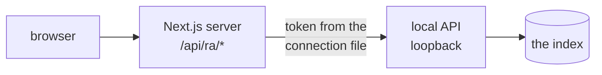
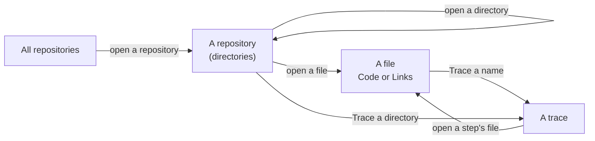

# RepoAtlas explorer

A local web app that draws the repositories RepoAtlas has indexed on this
machine. It reads the live index through `repoatlas serve` (see
[docs/local-api.md](../docs/local-api.md)); it never opens the database and
ships no data of its own.



## Run it

```sh
repoatlas ui
```

That is all. It starts the local API and this app together, opens
<http://127.0.0.1:7318> in your browser, and stops both on Ctrl-C. The first run
installs the packages and makes a production build (into `.next-ui/`); later
runs rebuild only when a source has changed. It needs Node.js 22 and pnpm 11
(or Node's corepack).

| Option | Effect |
|---|---|
| `--port 7320` | serve the explorer on another port |
| `--no-open` | do not open a browser |
| `--dev` | run `next dev` instead, with hot reload: for working on the explorer |
| `--rebuild` | rebuild even if the build looks current |
| `--prepare` | install and build, then exit (what `install.sh` runs) |
| `--frontend DIR` | run the explorer from another directory |

How the launcher works is in [docs/local-api.md](../docs/local-api.md#the-usual-way-repoatlas-ui).

### By hand, in two terminals

1. Start the local API. It prints where it wrote its connection file:

   ```sh
   repoatlas serve
   ```

2. Point the explorer at that file and start it:

   ```sh
   cd frontend
   pnpm install
   REPOATLAS_API_CONNECTION_FILE=~/.local/share/repoatlas/api.json pnpm dev
   ```

   Or put `REPOATLAS_API_CONNECTION_FILE=...` in `frontend/.env.local`.

3. Open <http://localhost:7318>.

The connection file is read on every request, so restarting `repoatlas serve`
needs no restart here. If the API is not running, the explorer says so and
shows the command to start it.

## What it shows

The explorer is built to be read, not to show every edge at once. It shows the
summary first and the detail when you ask for it.

- **All repositories.** A constellation. The selected repository, or else the
  one with the most partners, sits at the centre. Its partners ring it, and
  theirs ring them. Repositories linked only among themselves form their own
  small constellations beside it. Repositories with no links sit in their own
  group. When nothing links at all, the repositories ring the workspace hub,
  which says so.
- **A repository, opened.** The directory you are in is a frame around its
  cards: one per directory, listing what is in it, and one for its files.
  Each card counts its links per family instead of drawing them. At rest, only
  the level's totals are drawn: lanes from the frame to other repositories and
  elsewhere in this one (left), and to modules, packages, environment
  variables, commands and endpoints shared across the index (right).
- **A file.** It opens on its code, highlighted, with line numbers. Every name
  the file declares or refers to can be pressed: the first press selects it,
  and a second press, or **Trace**, follows it. **Links** switches to the
  file's neighbourhood: what links to it on the left, what it links to on the
  right, the strongest few on each side and "+N more" for the rest.
- **A trace.** What a change to one name, file or directory reaches, and by
  which indexed steps. It opens close on the thing that changes, then pulls
  back over the whole chain: each column one step further, each card a file the
  chain lands in, framed by repository when the chain leaves the one it
  started in. Choosing a row reads that step's lines.



**Search** (Ctrl+K or ⌘K, or `/`) finds repositories and files from two
letters; Enter takes the first result. With **Include variables** on, it also
finds the names code declares: functions, classes, methods, variables and the
environment variables code reads. The switch is remembered, and off at first.

Lines are drawn as a transit map draws them: straight runs joined by 45°
bends, in bold saturated colours, at full strength. A line's pattern is its
family and its colour is its relationship. Families are never merged into one
line, and a code link is drawn as one line per relationship it carries, side by
side, keeping one gap through every bend:

| Family | Relationship | Line |
|---|---|---|
| code | imports (imports, exports, requires, includes, sources) | solid, blue |
| code | calls (calls, executes) | solid, green |
| code | uses (uses, references) | solid, violet |
| code | other (defines, contains…) | solid, grey |
| HTTP | serves or calls a route or endpoint | dashed, teal |
| package dependency | depends on | double, magenta |
| configuration and environment variables | reads, configures | dotted, amber |
| the connection being explained | any | thick, in the accent (vermilion) |

A dot marks where a line leaves and an arrowhead where it arrives. It has one
of three weights by its count (a few, hundreds, thousands), a band of canvas
beneath it so crossings stay legible. At rest it runs under the cards; when it
is lit or selected it comes in front of them. One line of each link carries the link's total, on a tag filled in its
colour. The legend lists what the
level draws. Where code is summed (a card's tally, a family's heading in the
inspector) its mark shows blue, green and violet together. Each connection in
the inspector lists its relationships with their colours.

Everything a line joins is one quiet card, as a transit map draws one station
for every stop: a solid fill a step lighter than the canvas, with a clear
outline. Kinds are told apart by their icon and title, not by fill; a shared
thing's icon is drawn in the colour of the line that reaches it (modules blue,
commands green, packages magenta, configuration and environment variables
amber, HTTP teal). An opened directory is a district: a plain region a half
step above the canvas, its name set large like a place on a map. Each
repository has its own colour, shown as a solid square beside its name wherever
it appears. A faint grid squares the canvas and moves with it.

Each view has a toolbar above the canvas, saying where you are and what the
level holds. Below the canvas, a status bar holds the zoom and the key to the
lines; its ⓘ button names the marks.

The chrome is deliberately plain, so the colour on the canvas carries meaning.
It uses IBM Plex Sans and Plex Mono, served from the app itself, and warm
neutrals in both themes. The accent marks only what is selected, focused or
pressed next, and there are three corner radii (2, 4 and 6 px). The colour
tokens are in `lib/theme/tokens.ts`; every text tone keeps 4.5:1 contrast on
the backgrounds it sits on.

HTTP has three kinds of shared node, each in its own group: **HTTP routes**
(a method and path some code serves or calls), **HTTP endpoints** (a route at a
known address) and **Deployments**, drawn with a cloud: the addresses an API is
published at, such as an OpenAPI document's `servers`. In a file's code, the URL
that declares a deployment is marked, so it can be selected and traced like a
name, and the inspector's **Symbols** tab lists routes, endpoints and
deployments in sections of their own.

### Pointing, selecting, opening

| Action | Result |
|---|---|
| Point at a node (or focus it) | Previews its links; everything else fades. |
| First press | Selects it: its links stay lit with counts, and the inspector opens. |
| Second press, "Open", or Enter on the selected node | Goes in, zooming into it. |
| Location trail, or Back | Climbs out, zooming out onto where you came from. That node arrives selected. |
| Escape, or a press on empty canvas | Clears the selection. |

The inspector, docked beside the canvas (below it on a narrow window), holds
the detail:

- **Connections:** every link, by direction and family, strongest first.
- **Contents** or **Files:** what a directory holds.
- **Code:** a file's indexed source, with line numbers.
- **Details:** the facts the index has: size and lines from `inspect`, language,
  declarations.
- **Evidence:** for a chosen connection, the exact stored relationships behind
  it (`topology/edge`) and the lines that assert them. Evidence and source for
  one inspected thing share one investigation.

Where you are is in the URL
(`?repo=<slug>&path=<dir or file>&trace=<seed>&sel=<node>`), so a view can be
shared. Selecting replaces the history entry and going somewhere adds one, so
Back climbs out. Every step of the path a level shows is a button that climbs
straight to it.

Motion is limited to viewport transforms and opacity, from about 250ms to
560ms, with no animated backgrounds. The header's **Turn animations off**
switch stops it; until you choose, your system's reduced-motion setting
decides, and once you have chosen, your choice wins. The theme follows your
system, light or dark, until you switch it with the header's theme button.

## The `/api/ra` route

The browser only ever talks to its own origin. The route adds the API's bearer
token on the server, which makes it the one thing that must refuse other
callers: it answers only a loopback `Host` (a DNS-rebinding page arrives with
its own name), no cross-site request, JSON bodies up to 1 MiB, and only the
endpoints the contract lists (`sync` and `verify_grounding` are not among
them). It forwards only to a loopback `http://host:port` named by the
connection file. The token and the file's path never reach the browser.

## Checks

| Command | What it checks |
|---|---|
| `pnpm dto:check` | `lib/api/generated.ts` matches `python -m repoatlas.api.schema` |
| `pnpm typecheck` | strict TypeScript |
| `pnpm lint` | ESLint (Next's rules), no warnings allowed |
| `pnpm test` | unit tests: the route's refusals, the connection file, the models |
| `pnpm e2e` | Playwright against a production build and a real `repoatlas serve` |
| `pnpm check` | the first four together |

`pnpm dto` regenerates the types after the contract changes. It runs the
repository's `.venv/bin/python`, or `REPOATLAS_PYTHON`.

`pnpm e2e` runs two pipelines from one production build, each with its own
`repoatlas serve`:

- `live` (ports 7337/7338): the index your environment configures. In CI, set
  `REPOATLAS_CONFIG` and `REPOATLAS_DB` to a scratch workspace first.
- `linked` (ports 7347/7348): the linked test corpus, built fresh by
  `python -m tests.topology_corpus` into the system temp directory, never into
  the checkout (RepoAtlas would discover its repositories on the next sync).
  Its repositories link to each other, so the lines between repositories are
  tested even when a live index has none.

It needs Playwright's Chromium (`pnpm exec playwright install chromium`).
