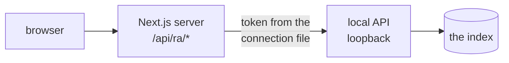

# RepoAtlas explorer

A local web app that draws the repositories RepoAtlas has indexed. It reads the live index through
`repoatlas serve` (see [docs/local-api.md](../docs/local-api.md)) and never opens the database.



## Run it

```sh
repoatlas ui
```

An installed release serves the explorer it ships with and needs nothing else. From a checkout, this starts the
local API and the app together, opens <http://127.0.0.1:7318>, and stops both on Ctrl-C. The first run installs
packages and builds into `.next-ui/`; later runs rebuild only when a source has changed. A checkout needs Node.js
20.19 or later and pnpm 10 (or Node's corepack).

| Option | Effect |
|---|---|
| `--port 7320` | serve on another port |
| `--no-open` | do not open a browser |
| `--dev` | run `next dev` with hot reload, for working on the explorer |
| `--rebuild` | rebuild even if the build looks current |
| `--prepare` | install and build, then exit (what `install.sh` runs) |
| `--frontend DIR` | run from another directory, or serve an export (`out/`) |

How the launcher works is in [docs/local-api.md](../docs/local-api.md#the-usual-way-repoatlas-ui).

### By hand, in two terminals

1. Start the local API. It prints where it wrote its connection file: `repoatlas serve`
2. In `frontend/`, point the explorer at that file and start it:

   ```sh
   pnpm install
   REPOATLAS_API_CONNECTION_FILE=~/.local/share/repoatlas/api.json pnpm dev
   ```

   You can also put `REPOATLAS_API_CONNECTION_FILE=...` in `frontend/.env.local`.

3. Open <http://localhost:7318>.

The connection file is read on every request, so restarting `repoatlas serve` needs no restart here. If the API is
not running, the explorer says so and shows the command to start it.

### As shipped: a static export

A released RepoAtlas does not run this app's server. The release build exports the app as plain files, which go into
the Python package:

```sh
pnpm build:static        # RA_EXPORT=1 next build: writes out/
```

The export leaves out the one server route, `app/api/ra/[...path]/route.ts`. The local API serves the files and
answers `/api/ra/<name>` itself, with the same checks, so the browser code is identical in both. To try an export
from a checkout: `repoatlas ui --frontend frontend/out`. Keep anything that needs a server out of the pages, or
`pnpm build:static` fails.

## What it shows

The explorer shows the summary first and the detail when you ask for it.

- **All repositories:** the selected repository, or the one with the most partners, sits at the centre, with its
  partners around it.
- **A repository:** the directory you are in, as cards: one per directory, plus its files. Each card counts its links
  per family rather than drawing them.
- **A file:** opens on its highlighted code. Press a name to select it; press again, or **Trace**, to follow it.
  **Links** shows what links to the file on the left and what it links to on the right.
- **A trace:** what a change to one name, file or directory reaches, and by which indexed steps. Choosing a row reads
  that step's lines.

**Search** (Ctrl+K, ⌘K or `/`) finds repositories and files from two letters. With **Include variables** on, it also
finds declared names and environment variables.

### Reading the lines

A line's pattern is its family and its colour is its relationship. Families are never merged.

| Family | Relationship | Line |
|---|---|---|
| code | imports | solid, blue |
| code | calls | solid, green |
| code | uses | solid, violet |
| code | other (defines, contains…) | solid, grey |
| HTTP | serves or calls a route or endpoint | dashed, teal |
| package dependency | depends on | double, magenta |
| configuration and environment variables | reads, configures | dotted, amber |
| the connection being explained | any | thick, vermilion |

A dot marks where a line leaves and an arrowhead where it arrives. One line of each link carries the link's total.
The legend lists what each level draws, and the status bar's ⓘ button names the marks.

### HTTP

HTTP has three kinds of shared node: **HTTP routes** (a method and path some code serves or calls), **HTTP
endpoints** (a route at a known address), and **Deployments** (addresses an API is published at, such as an OpenAPI
document's `servers`). The inspector's **Symbols** tab lists them.

A line between two repositories means a proven relationship. For HTTP, that is a handler link: every hop from a
request to one handler was proven from the source. A request the join refused is never drawn; it is listed under
**Requests**, with its exact status (such as `http-route-unmatched` or `http-base-unknown`). Requests the join only
reads are hidden until **Show join-only requests** is on.

A decision's chain reads as seven hops: caller, origin, service identity, deployment binding, source binding, route,
handler. Each hop shows its state (`proven`, `unresolved`, `ambiguous`, `not_reached`) and, when it is not proven, the
reason.

### Navigating

| Action | Result |
|---|---|
| Point at a node | Previews its links; everything else fades. |
| First press | Selects it and opens the inspector. |
| Second press, "Open", or Enter | Goes in, zooming into it. |
| Location trail, or Back | Climbs out to where you came from. |
| Escape, or a press on empty canvas | Clears the selection. |

The inspector holds the detail: **Connections**, **Contents** or **Files**, **Code**, **Details** (size, language,
declarations), and **Evidence** for a chosen connection. Where you are is in the URL
(`?repo=<slug>&path=<dir or file>&trace=<seed>&sel=<node>`), so a view can be shared.

Motion is limited to transforms and opacity. The header's **Turn animations off** switch stops it; until you choose,
your system's reduced-motion setting decides. The theme follows your system until you change it with the header's
theme button.

## The `/api/ra` route

The browser only talks to its own origin. The route adds the API's bearer token on the server, so it must refuse
other callers: it answers only a loopback `Host`, rejects cross-site requests, caps JSON bodies at 1 MiB, and forwards
only the endpoints the contract lists (`sync` and `verify_grounding` are not among them). It forwards only to the
loopback address in the connection file. The token and the file's path never reach the browser.

An exported build has no route; the local API applies the same checks itself
(`repoatlas/api/server.py`, [docs/local-api.md](../docs/local-api.md#an-installed-release-one-server)).

## Checks

| Command | What it checks |
|---|---|
| `pnpm dto:check` | `lib/api/generated.ts` matches `python -m repoatlas.api.schema` |
| `pnpm typecheck` | strict TypeScript |
| `pnpm lint` | ESLint, no warnings allowed |
| `pnpm test` | unit tests: the route's refusals, the connection file, the models |
| `pnpm e2e` | Playwright against a production build and a real `repoatlas serve` |
| `pnpm check` | the first four together |

`pnpm dto` regenerates the types after the contract changes. It runs the repository's `.venv/bin/python`, or
`REPOATLAS_PYTHON`.

`pnpm e2e` runs two pipelines from one production build, each with its own `repoatlas serve`:

- `live` (ports 7337/7338): the index your environment configures. In CI, set `REPOATLAS_CONFIG` and `REPOATLAS_DB`
  to a scratch workspace first.
- `linked` (ports 7347/7348): the test corpus built by `python -m tests.topology_corpus` into the system temp
  directory, never the checkout. Its repositories link to each other, so the lines between them are always tested.

It needs Playwright's Chromium (`pnpm exec playwright install chromium`).
